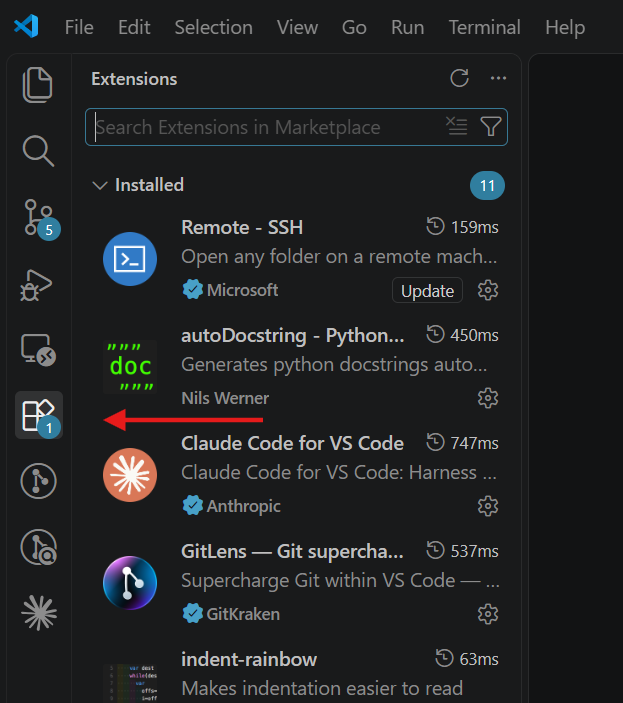
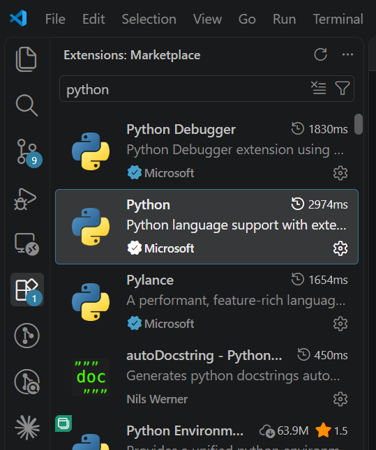
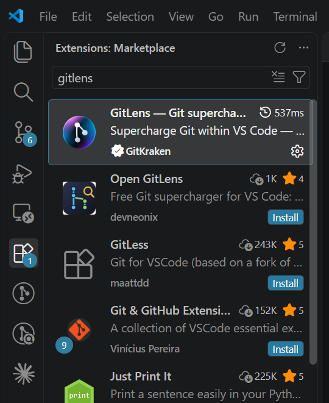
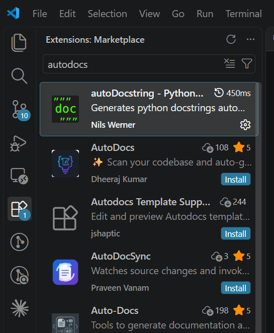
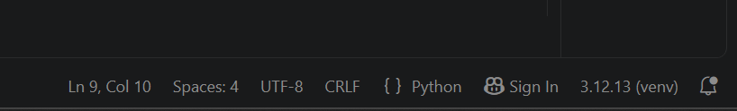
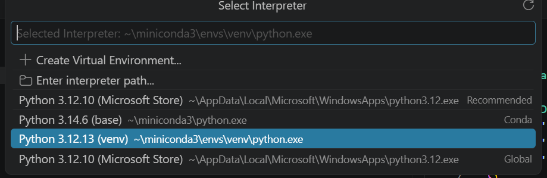
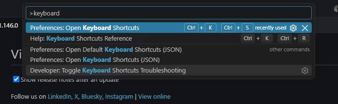

# Estructura del curso

Curso de 4 horas, dividido en dos mitades. Este documento recoge el guion y los tiempos orientativos; el contenido de cada sección es el material de apoyo, no el detalle del guion en sí.

## Primera mitad: entorno y buenas prácticas de código

| Bloque | Duración estimada | Tipo |
|---|---|---|
| [Preparación de nuestro entorno de trabajo](#preparación-de-nuestro-entorno-de-trabajo) | 30-45 min | Práctica (el setup siempre da problemas, hay que dejarle margen) |
| [Estándares de escritura de código](#estándares-de-escritura-de-código) | 15-20 min | Teoría breve + práctica: formatear, tipar y documentar una función (`isort`/`black`, type hints, docstring) |
| [Python debugger](#python-debugger) | ~2 min | Recordatorio exprés (el grupo ya lo ha visto en un curso anterior): `breakpoint()` y los comandos básicos |
| [Testing con pytest](#testing-con-pytest) | 30-45 min | Práctica: tests sobre una función, comparación de floats, y validación de datos con `pandera`/`polars` |

`Proyectos` (`pyproject.toml`) se queda como mención de una línea dentro de Estándares, sin bloque propio. `Logging` se cubre como complemento breve sin tiempo específico asignado, encajado al final del bloque de Estándares.

Lo que sobre de esta primera mitad se dedica a introducir la filosofía de git, de cara a la segunda mitad.

## Segunda mitad: historial de versiones (git)

Bloque más hands-on, adaptando el nivel según pilote el grupo. Idealmente transversal: el material del curso se descarga desde el principio del día usando git (a confirmar). Ver detalle en [Historial de versiones (git)](#historial-de-versiones-git).

* **Núcleo (se cubre sí o sí):** filosofía (commits, ramas, trazabilidad), configuración inicial de identidad y autenticación (`git config --global`, claves SSH — práctica), comandos básicos (`status`, `add`, `commit`, `pull`, `push`, `reset`, `branch`, `checkout`, `merge`), conflictos, metodologías (filosofía del commit y trazabilidad, no solo feature branches — bloque teórico).
* **Si da tiempo:** `stash`, `fork`, `cherry-pick`, `rebase`, `squash`, issues, pull requests, revisiones de código, normas de repo.
* **Avanzado / solo si el grupo pilota:** actions / pipelines de CI. Previsión: probablemente no se llegue a ver, pero se prepara por si acaso.

# Preparación de nuestro entorno de trabajo

Antes de escribir una sola línea de código, es importante dejar el entorno de trabajo bien configurado: un entorno mal preparado es una fuente habitual de errores confusos (paquetes que "no se encuentran", intérpretes equivocados, etc.) que no tienen que ver con el código en sí. Esta guía recoge, paso a paso, cómo dejar todo listo.

Partimos de la base de que trabajamos en:
* Un dispositivo windows.
* Con VS Code instalado.
* Con Python y pip ya instalados.
* Con Git instalado (necesario más adelante, para el bloque de [Historial de versiones (git)](#historial-de-versiones-git)).

## Extensiones de VS Code

Instalamos las siguientes extensiones de VS Code. Cada una cubre una necesidad concreta a la hora de trabajar con Python:

* [Python](https://marketplace.visualstudio.com/items?itemName=ms-python.python): añade el soporte esencial para trabajar con Python en VS Code (autocompletado, linting, depuración y, sobre todo, la posibilidad de seleccionar qué intérprete/entorno virtual usa el editor).
* [GitLens](https://marketplace.visualstudio.com/items?itemName=eamodio.gitlens): enriquece la integración de Git en VS Code, mostrando quién y cuándo modificó cada línea, historial de commits, comparación de cambios, etc.
* [autoDocstring](https://marketplace.visualstudio.com/items?itemName=njpwerner.autodocstring): genera automáticamente la plantilla de un docstring al escribir `"""` bajo la definición de una función, ayudando a mantener el código documentado.

El proceso para instalar cualquiera de ellas desde VS Code es siempre el mismo: abrir el panel de extensiones desde el icono correspondiente en la barra lateral izquierda, buscar el nombre de la extensión en el marketplace y pulsar "Install" sobre el resultado correcto (atención con extensiones de nombre parecido pero de otro autor).



Búsqueda de cada una de las tres extensiones:

**Python**



**GitLens**



**autoDocstring**



## Entornos virtuales

Trabajar con un entorno virtual por proyecto nos permite instalar las dependencias necesarias sin que entren en conflicto con las de otros proyectos ni con la instalación base del sistema. Usamos el módulo `venv` de la librería estándar, que no requiere instalar nada adicional.

**Ejercicio**: crear un entorno virtual, activarlo, instalar un paquete, desactivarlo y, por último, crear un segundo entorno e instalar en él las dependencias de un proyecto ya existente a partir de un `requirements.txt`.

Creamos un entorno virtual llamado `venv`:

```powershell
python -m venv venv
```

`-m venv` ejecuta el módulo `venv` de la librería estándar; el segundo `venv` es el nombre que le damos a la carpeta del entorno (podría ser cualquier otro). Esto crea una carpeta `venv` con una copia aislada del intérprete y de `pip`.

Activamos el entorno que acabamos de crear:

```powershell
.\venv\Scripts\Activate.ps1
```

El prompt de PowerShell pasa a mostrar `(venv)` al principio de la línea: a partir de aquí, `python` y `pip` en esta sesión son los de esta carpeta, no los del sistema.

¿PowerShell se queja de que no puede ejecutar scripts? Por defecto, Windows bloquea la ejecución de scripts `.ps1` por motivos de seguridad. Para permitirlo únicamente en la sesión actual:

```powershell
Set-ExecutionPolicy -Scope Process -ExecutionPolicy Bypass
```

Instalamos un paquete dentro del entorno activo:

```powershell
pip install requests
```

Al estar el entorno activado, el paquete se instala solo dentro de `venv`, sin afectar a la instalación base del sistema ni a otros entornos.

Desactivamos el entorno:

```powershell
deactivate
```

La terminal vuelve a usar el `python`/`pip` del sistema. La carpeta `venv` sigue existiendo con el paquete instalado; basta con activarla de nuevo para volver a usarla.

Para un proyecto que ya trae definidas sus dependencias en un fichero `requirements.txt`, repetimos el proceso con un entorno nuevo e instalamos todo de una vez en lugar de paquete a paquete. Como ya existe una carpeta `venv` del paso anterior, la borramos primero para partir de un entorno limpio:

```powershell
Remove-Item -Recurse -Force venv
python -m venv venv
.\venv\Scripts\Activate.ps1
pip install -r requirements.txt
```

`Remove-Item -Recurse -Force` borra la carpeta `venv` y todo su contenido sin pedir confirmación. No es un paso obligatorio en general (podríamos usar otro nombre de carpeta para el segundo entorno y convivir con los dos), pero aquí reutilizamos el mismo nombre para no acumular entornos de prueba durante el ejercicio.

`-r requirements.txt` le dice a `pip` que instale cada paquete y versión listados en ese fichero. Es la forma habitual de dejar un proyecto reproducible: cualquiera que lo descargue puede recrear el mismo entorno con ese único comando, en vez de tener que adivinar qué paquetes instalar a mano.

Y la operación inversa: si ya tenemos un entorno con paquetes instalados y queremos dejar constancia de ellos para que el proyecto sea reproducible, generamos el `requirements.txt` a partir del entorno activo:

```powershell
pip3 freeze > requirements.txt
```

`pip freeze` lista todos los paquetes instalados en el entorno activo junto con su versión exacta, y `>` redirige esa salida a un fichero en lugar de mostrarla por pantalla. Es el comando que normalmente se ejecuta justo antes de subir el proyecto al repositorio, para que el `requirements.txt` quede siempre actualizado con lo que realmente se está usando.

## Vincular Python con VS Code

Queremos vincular nuestro VS Code con el ejecutable con el que vamos a trabajar: el del entorno virtual que hemos creado.

Si abrimos un script Python veremos que en la esquina inferior derecha de VS Code hay información relativa al fichero y, gracias a la extensión que hemos instalado, información sobre el ejecutable de python con el que trabaja VS Code:



Si hacemos click en `venv` abriremos un panel en el que podemos ver los diferentes ejecutables. Si el que queremos no aparece, podemos simplemente introducir la ruta del mismo:



## Atajos de teclado útiles

Unos pocos atajos ahorran muchos viajes al ratón durante la sesión:

* `Ctrl S`: guarda el fichero. El más fundamental de todos — sin guardar, ningún cambio llega al intérprete, ni tampoco a `black`/`isort` si están configurados para ejecutarse al guardar.
* `Alt` + flechas arriba/abajo: añade un cursor en la línea de encima o debajo de la actual (multicursor), para escribir o editar varias líneas a la vez en lugar de repetir la misma edición línea a línea.
* `Ctrl B`: muestra u oculta la barra lateral del explorador de ficheros, para ganar espacio de pantalla una vez sabemos en qué fichero estamos trabajando.
* `Ctrl Ñ` (o `Ctrl J` si el teclado no responde bien a esa combinación): muestra u oculta el panel inferior, donde vive la terminal integrada. En teclado español conviene saber que existe esta alternativa, porque el atajo "oficial" (`` Ctrl ` ``) no siempre se comporta igual según el teclado.
* `Ctrl Shift P`: abre la paleta de comandos, el buscador universal de VS Code. Sirve también para encontrar el atajo de cualquier acción: basta con buscar "keyboard shortcuts" para abrir la chuleta (*cheat sheet*) oficial con todos los atajos disponibles.



# Estándares de escritura de código

Se trata tanto del uso de ciertas herramientas como de implementar un método de trabajo estandarizado.

La estandarización del código es un elemento clave de cara al propio proceso de desarrollo y de su mantenimiento: cuando todo el equipo escribe el código siguiendo las mismas convenciones, cualquier persona puede leer y modificar el código de otra sin tener que adaptarse primero a un estilo distinto, se reducen las discusiones subjetivas en las revisiones de código (*code review*) y resulta mucho más sencillo detectar errores a simple vista.

## Libro de estilos

Un libro de estilos (*style guide*) es un conjunto de normas y convenciones que definen cómo se debe escribir el código: nombres de variables, funciones y clases, longitud máxima de línea, forma de organizar los imports, uso de comentarios, etc.

En Python, la referencia de facto es [PEP 8](https://peps.python.org/pep-0008/), la guía de estilo oficial del propio lenguaje, que se detalla en el siguiente apartado.

Asimismo, es importante tener un documento de este tipo a nivel organizacional o departamental para definir un estándar común.

## pep8

[PEP 8](https://peps.python.org/pep-0008/) (*Python Enhancement Proposal 8*) es el documento oficial que recoge las convenciones de estilo para escribir código Python. Entre otras cosas, establece:

* Usar 4 espacios por nivel de indentación (nunca tabuladores).
* Limitar las líneas a un máximo de 79-99 caracteres, según el criterio del equipo.
* Nombrar variables y funciones en `snake_case`, las clases en `PascalCase` y las constantes en `MAYUSCULAS_CON_GUION_BAJO`.
* Dejar dos líneas en blanco entre definiciones de funciones/clases a nivel de módulo.
* Importar módulos en un orden concreto (librería estándar, librerías de terceros, módulos propios).

Seguir PEP8 "a mano" es tedioso y propenso a errores, por eso en la práctica se delega en herramientas automáticas de análisis (*linters*) como [flake8](https://flake8.pycqa.org/) o [pylint](https://pylint.readthedocs.io/), que revisan el código y avisan de las líneas que no cumplen la convención, y en herramientas de formateo automático (ver el apartado [Formateado automático del código](#formateado-automático-del-código)) que corrigen el código directamente.

En esta guía no profundizamos en la instalación y configuración de `flake8` o `pylint` como herramientas independientes, ya que la extensión de Python de VS Code que instalamos al principio (ver [Extensiones de VS Code](#extensiones-de-vs-code)) ya integra este mismo tipo de análisis (avisos de estilo, errores comunes, variables no usadas, etc.) directamente en el editor, sin configuración adicional. Aun así, si queréis conocer estas herramientas en detalle o usarlas fuera de VS Code (por ejemplo, en una pipeline de integración continua), podéis consultar su documentación oficial en los enlaces anteriores.

## Nombres significativos

PEP8 fija la forma de los nombres (`snake_case`, `PascalCase`...), pero no dice nada sobre si el nombre en sí comunica algo. Esto no depende de ninguna herramienta automática: es una decisión que toma quien escribe el código, y es una de las prácticas más baratas de aplicar y con más impacto en la legibilidad.

```python
def f(l):
    t = 0
    for x in l:
        t += x
    return t
```

Esta función funciona igual que la siguiente, pero nombrada así no dice nada hasta que se lee el cuerpo entero:

```python
def sumar_lista(numeros):
    total = 0
    for numero in numeros:
        total += numero
    return total
```

Con nombres descriptivos, la firma de la función ya adelanta qué hace, sin necesidad de leer la implementación ni de añadir comentarios explicativos.

## Type hinting

El *type hinting* (anotación de tipos) es una funcionalidad del lenguaje, disponible desde Python 3.5, que permite indicar de forma explícita qué tipo de dato espera una variable, un parámetro de una función o el valor que devuelve:

```python
def saluda(nombre: str) -> str:
    return f"Hola, {nombre}"
```

Aquí `nombre: str` indica que el parámetro debe ser una cadena de texto, y `-> str` indica que la función devuelve también una cadena de texto.

Es importante tener en cuenta que Python **no obliga** a que estos tipos se cumplan en tiempo de ejecución: son solo anotaciones informativas. Su utilidad viene de que:

* Hacen el código más legible, ya que documentan directamente en la firma de la función qué se espera.
* Permiten que el editor (VS Code, gracias a la extensión de Python) ofrezca autocompletado y detecte errores mientras escribimos, sin necesidad de ejecutar el código.
* Herramientas de análisis estático como `mypy` pueden comprobar, antes de ejecutar el programa, si los tipos declarados son consistentes en todo el código, detectando así errores que de otro modo solo aparecerían en tiempo de ejecución.

## Docstring

Un docstring es una cadena de texto especial que se escribe justo debajo de la definición de un módulo, clase o función, y que documenta su propósito, sus parámetros y lo que devuelve:

```python
def saluda(nombre: str) -> str:
    """Devuelve un saludo personalizado para la persona indicada.

    Args:
        nombre: Nombre de la persona a saludar.

    Returns:
        Cadena de texto con el saludo.
    """
    return f"Hola, {nombre}"
```

A diferencia de un comentario normal (`#`), el docstring queda accesible en tiempo de ejecución a través del atributo `__doc__` de la función, y es lo que se muestra al llamar a `help(saluda)` o al pasar el ratón por encima de la función en VS Code.

Existen varios formatos de docstring (Google, NumPy, reStructuredText...); lo importante es elegir uno y ser consistentes en todo el proyecto. La extensión [autoDocstring](#extensiones-de-vs-code) que instalamos al principio genera automáticamente la plantilla del docstring en el formato que configuremos, a partir de la firma de la función.

## Formateado automático del código

Más allá de revisar que el código cumple el estilo, existen herramientas que lo reescriben automáticamente para que lo cumpla, sin necesidad de corregirlo a mano. Recomendamos el uso de las librerías `isort` y `black`:

* `isort` ordena y agrupa automáticamente los `import` de un fichero (librería estándar, librerías de terceros y módulos propios), siguiendo el orden recomendado por PEP8.
* `black` reformatea el resto del código (indentación, comillas, saltos de línea, espacios...) de forma determinista y con muy pocas opciones de configuración, lo que evita discusiones de estilo dentro del equipo: "así es como lo formatea black" y punto.

Se instalan con:

```powershell
pip install isort black
```

Y se ejecutan sobre un fichero o carpeta con:

```powershell
isort .
black .
```

Es habitual configurar estas herramientas para que se ejecuten automáticamente al guardar el fichero, o como parte de un *pre-commit hook* antes de cada commit, de forma que ningún código sin formatear llegue al repositorio.

## Práctica

De código desordenado a código estándar, sobre un único fichero que vamos puliendo en pasos: formateo (`isort`/`black`), tipos, docstring. Punto de partida en `practicas/estandares/operaciones.py`; solución completa en `practicas/estandares/solucion/operaciones.py`.

Punto de partida:

```python
import sys
import requests
import os


def suma(a,b):
    return a+b
def resta(a, b):
    return a - b
```

Paso 1, formateo:

```powershell
isort operaciones.py
black operaciones.py
```

```python
import os
import sys

import requests


def suma(a, b):
    return a + b


def resta(a, b):
    return a - b
```

Paso 2, type hinting en `suma` y `resta` (parámetros y retorno). Paso 3, docstring en ambas. El resultado final es exactamente `practicas/estandares/solucion/operaciones.py`, ya visto en la sección de [Docstring](#docstring).

### Si da tiempo

Mismo mecanismo, con tipos menos triviales que un `int`/`str` suelto — para ver qué poner cuando el parámetro es una colección o un tipo de una librería de terceros. Ficheros en `practicas/estandares/si_da_tiempo/` (con su `solucion/`).

Una lista:

```python
def media(numeros: list[float]) -> float:
    """Devuelve la media de una lista de números."""
    return sum(numeros) / len(numeros)
```

`list[float]`: tipo genérico de la librería estándar (desde Python 3.9), sin necesidad de importar `typing.List`.

Un `DataFrame` de polars:

```python
def filtrar_mayores(
    df: pl.DataFrame, columna: str, umbral: float
) -> pl.DataFrame:
    """Filtra las filas donde una columna supera un umbral."""
    return df.filter(pl.col(columna) > umbral)
```

El tipo viene de la propia librería (`pl.DataFrame`): el type hint no se limita a los tipos nativos de Python, funciona igual con tipos de terceros.

Ya que hablamos de estandarizar, esto no se limita al propio código: también existe un estándar para centralizar la configuración del proyecto en sí, el fichero `pyproject.toml` (ver [Proyectos](#proyectos)).

# Python debugger

La herramienta principal para debuggear Python es la librería estándar `pdb` (*Python DeBugger*), que no requiere instalación adicional al venir incluida con el propio intérprete.

Para detener la ejecución del programa en un punto concreto y entrar en modo interactivo, basta con insertar la siguiente línea en el código:

```python
breakpoint()
```

`breakpoint()` es la forma recomendada desde Python 3.7 de arrancar el depurador (internamente invoca a `pdb.set_trace()`). Al llegar a esa línea, la ejecución se detiene y se abre una consola interactiva en la que podemos inspeccionar el estado del programa.

Dentro de esa consola, los comandos más habituales son:

* `n` (*next*): ejecuta la siguiente línea sin entrar en las funciones que llame.
* `s` (*step*): ejecuta la siguiente línea, entrando dentro de la función si la hay.
* `c` (*continue*): continúa la ejecución hasta el siguiente `breakpoint()` o hasta que termine el programa.
* `l` (*list*): muestra el código alrededor de la línea actual.
* `p <expresión>` (*print*): evalúa e imprime el valor de una variable o expresión.
* `q` (*quit*): sale del depurador y termina la ejecución.

Este flujo de trabajo permite inspeccionar el valor real de las variables en el momento exacto en que ocurre un problema, en lugar de deducirlo a partir de `print()` colocados manualmente por el código.

# Proyectos

Cuando un script suelto crece hasta convertirse en un paquete instalable (varios módulos, dependencias propias, quizás una CLI), conviene formalizar su configuración en un único fichero estándar en lugar de dispersarla en varios scripts.

Históricamente, en Python esto se resolvía con un fichero `setup.py`: un script de Python que, al ejecutarse, instalaba el paquete y declaraba sus metadatos (nombre, versión, dependencias...). Si trabajáis con proyectos veteranos es muy probable que os lo encontréis, pero hoy en día se considera un enfoque en desuso, entre otras cosas porque al ser código ejecutable (y no una simple declaración de datos) resulta menos seguro y más difícil de analizar por otras herramientas.

El estándar actual es el fichero `pyproject.toml`, definido en [PEP 518](https://peps.python.org/pep-0518/) y ampliado posteriormente en [PEP 621](https://peps.python.org/pep-0621/). Es un único fichero, en formato TOML (texto plano, declarativo, sin código ejecutable), situado en la raíz del proyecto, que centraliza:

* Los metadatos del proyecto: nombre, versión, descripción, autoría, dependencias y versión mínima de Python requerida.
* La configuración del sistema de *build* usado para empaquetarlo (`setuptools`, `hatchling`, `poetry`, etc.).
* Opcionalmente, la configuración de otras herramientas del propio proyecto (`black`, `isort`, `pytest`...), que de otro modo requerirían cada una su propio fichero de configuración suelto en la raíz.

No nos detenemos aquí en el detalle de cómo estructurar los directorios de un paquete ni en las distintas variables de configuración de `pyproject.toml`: el objetivo es simplemente que conozcáis que este es el estándar actual y para qué sirve. Adoptarlo o no es una decisión que depende del tipo de proyecto y de su envergadura: para un script o notebook de uso puntual probablemente sea un sobrecoste innecesario, pero en cuanto el proyecto vaya a distribuirse, instalarse en otros entornos o mantenerse en el tiempo, merece la pena partir de esta estructura desde el principio.

# Testing con pytest

Depurar con `pdb` ayuda a resolver un error puntual, pero no evita que ese mismo error vuelva a aparecer la próxima vez que alguien toque ese código. Los tests automáticos son lo que permite comprobar, en segundos y sin intervención manual, que el programa se sigue comportando como esperamos después de cada cambio.

Hay varias formas de comprobar que el código hace lo que esperamos, con distinto nivel de comodidad:

* De forma manual, con `assert` sueltos en un script que ejecutamos a mano cada vez.
* [unittest](https://docs.python.org/3/library/unittest.html), el módulo de testing de la librería estándar: requiere definir clases que heredan de `TestCase`, con métodos como `assertEqual`, `assertTrue`...
* [pytest](https://docs.pytest.org/), la opción que vemos aquí y la más usada hoy en día en proyectos nuevos.

Frente a `unittest`, `pytest` no requiere definir clases ni heredar de nada: un test es simplemente una función cuyo nombre empieza por `test_`, y las comprobaciones se hacen con `assert`:

```python
# test_saludo.py
from saludo import saluda

def test_saluda_devuelve_el_nombre():
    assert saluda("Ana") == "Hola, Ana"
```

Se instala con:

```powershell
pip install pytest
```

Y se ejecuta apuntando a la carpeta o fichero de tests:

```powershell
pytest
```

`pytest` descubre automáticamente todos los ficheros `test_*.py` (o `*_test.py`) y todas las funciones `test_*` dentro de ellos, los ejecuta y muestra un resumen indicando cuántos han pasado y, para los que fallan, en qué línea y con qué valores concretos.

No entramos aquí en técnicas más avanzadas (*fixtures*, *mocking*, tests parametrizados...); el objetivo es dejar claro el hábito clave: por cada función con lógica no trivial, escribir al menos un test que documente qué se espera de ella y que sirva de red de seguridad ante futuros cambios.

## Ojo con los floats

Por cómo se representan internamente, dos operaciones con decimales que matemáticamente deberían dar el mismo resultado pueden no ser iguales bit a bit:

```python
>>> 0.1 + 0.2 == 0.3
False
```

En un test esto se traduce en falsos negativos: un test que debería pasar falla porque compara floats con `==`. Para esto, `pytest` incluye `pytest.approx`, que compara con una tolerancia en vez de una igualdad exacta:

```python
def test_suma_decimales():
    assert suma(0.1, 0.2) == pytest.approx(0.3)
```

Trabajando con importes, tipos de interés o cualquier cálculo con decimales, comparar floats con `==` a secas es un error fácil de cometer y fácil de pasar por alto en una revisión de código.

**Práctica 1**: escribir tests para `suma` y `resta` (`practicas/testing/operaciones.py`, la misma función que ya formateamos y documentamos en el bloque anterior), incluyendo un caso con decimales.

```python
# practicas/testing/test_operaciones.py
import pytest

from operaciones import resta, suma


def test_suma():
    assert suma(2, 3) == 5


def test_suma_con_negativos():
    assert suma(-2, 3) == 1


def test_suma_decimales():
    assert suma(0.1, 0.2) == pytest.approx(0.3)


def test_resta():
    assert resta(5, 3) == 2
```

```powershell
pytest practicas/testing
```

**Práctica 2**: testing, pero aplicado a los datos en lugar de al código. [pandera](https://pandera.readthedocs.io/) permite declarar el esquema que debe cumplir un `DataFrame` (tipos de columna, rangos válidos...) y comprobar que un `DataFrame` concreto lo cumple, de forma muy similar a como declaramos type hints en una función. Ejemplo con una tabla de movimientos bancarios:

```python
# practicas/testing/validacion.py
import pandera.polars as pa


class Movimientos(pa.DataFrameModel):
    id_cliente: int = pa.Field(gt=0)
    importe: float = pa.Field(ge=-10_000, le=10_000)
```

```python
# practicas/testing/test_validacion.py
import polars as pl
import pytest
from pandera.errors import SchemaError

from validacion import Movimientos


def test_datos_validos():
    df = pl.DataFrame({"id_cliente": [1, 2], "importe": [150.50, -32.10]})
    Movimientos.validate(df)


def test_datos_invalidos():
    df = pl.DataFrame({"id_cliente": [1, -2], "importe": [150.50, 50_000.0]})
    with pytest.raises(SchemaError):
        Movimientos.validate(df)
```

`Movimientos.validate(df)` no devuelve nada si el `DataFrame` cumple el esquema; si no lo cumple, lanza un `SchemaError` con el detalle de qué columna y qué valores lo han incumplido (aquí, un `id_cliente` negativo y un `importe` fuera del rango permitido). Es la misma idea que un test normal, pero en vez de comprobar que una función se comporta como esperamos, comprobamos que los datos tienen la forma que esperamos — especialmente importante en cuanto el código empieza a depender de datos que vienen de fuera (un CSV, una base de datos, una API...) y que nadie garantiza que lleguen limpios.

## Si da tiempo

Hasta ahora solo hemos comprobado un resultado concreto (`assert x == y`). Pero no todo lo que queremos comprobar de una función es su valor de retorno: a veces lo que nos interesa es que falle de forma controlada ante una entrada inválida, en vez de devolver cualquier cosa.

**Práctica**: añadir `dividir` a `practicas/testing/si_da_tiempo/operaciones.py` (ya está escrita) y testearla — `pytest.raises` comprueba que se lanza una excepción concreta:

```python
def dividir(a: float, b: float) -> float:
    if b == 0:
        raise ValueError("No se puede dividir por cero")
    return a / b
```

```python
# practicas/testing/si_da_tiempo/test_operaciones.py
import pytest

from operaciones import dividir


def test_dividir():
    assert dividir(6, 3) == 2


def test_dividir_por_cero():
    with pytest.raises(ValueError):
        dividir(6, 0)
```

`with pytest.raises(ValueError):` falla el test si el bloque de dentro **no** lanza un `ValueError`; si lo lanza, el test pasa. Es la forma de comprobar que un error se produce donde esperamos que se produzca, en vez de dejar que se propague sin control.

Para quien quiera profundizar más allá de la sesión, algunas técnicas y enfoques que no nos da tiempo a cubrir hoy:

* [Fixtures](https://docs.pytest.org/en/stable/how-to/fixtures.html): preparar datos de prueba reutilizables entre varios tests, en vez de repetirlos en cada función.
* [Parametrize](https://docs.pytest.org/en/stable/how-to/parametrize.html): ejecutar el mismo test con varios juegos de entrada/salida sin duplicar código.
* [TDD (Test-Driven Development)](https://en.wikipedia.org/wiki/Test-driven_development): invertir el orden que hemos visto en la sesión — escribir primero el test (que fallará, porque la función aún no existe) y después el código que lo hace pasar.

# Logging

`print()` es cómodo para depurar en local, pero como mecanismo permanente para que un programa informe de lo que hace tiene varias limitaciones: no distingue niveles de importancia (un aviso no es lo mismo que un error grave), no indica de forma automática cuándo ni desde qué parte del código se generó el mensaje, y es difícil de silenciar o redirigir sin tocar el código fuente.

El módulo estándar [`logging`](https://docs.python.org/3/library/logging.html) resuelve estos problemas:

```python
import logging

logging.basicConfig(level=logging.INFO)
logger = logging.getLogger(__name__)

logger.info("Proceso iniciado")
logger.warning("El fichero de configuración no existe, se usan valores por defecto")
logger.error("No se ha podido conectar con la base de datos")
```

Cada mensaje se emite con un nivel de gravedad (de menor a mayor: `DEBUG`, `INFO`, `WARNING`, `ERROR`, `CRITICAL`), y `basicConfig(level=...)` fija el umbral a partir del cual esos mensajes se muestran realmente: por ejemplo, con `level=logging.INFO` los mensajes `DEBUG` quedan silenciados, sin necesidad de borrarlos ni de comentarlos en el código, mientras que en desarrollo basta con bajar el umbral a `DEBUG` para ver también ese detalle adicional.

Usar `logging.getLogger(__name__)` en lugar del logger raíz también permite que cada módulo emita sus mensajes identificado por su propio nombre, lo que facilita saber de dónde viene cada línea cuando el proyecto crece y tiene varios ficheros.

## Configuración con handlers

`basicConfig` vale para empezar, pero en cuanto queremos que los logs vayan a más de un sitio a la vez (por ejemplo, a la consola y a un fichero), necesitamos configurar los *handlers* a mano:

```python
import logging
from logging.handlers import RotatingFileHandler

logger = logging.getLogger(__name__)
logger.setLevel(logging.INFO)

formatter = logging.Formatter("%(asctime)s %(levelname)s %(name)s: %(message)s")

stream_handler = logging.StreamHandler()
stream_handler.setFormatter(formatter)

file_handler = RotatingFileHandler("app.log", maxBytes=1_000_000, backupCount=3)
file_handler.setFormatter(formatter)

logger.addHandler(stream_handler)
logger.addHandler(file_handler)
```

* `StreamHandler` envía los mensajes a la consola (igual que haría un `print()`).
* `RotatingFileHandler` los escribe en un fichero (`app.log`); al llegar a `maxBytes`, lo rota: renombra el fichero actual y empieza uno nuevo, conservando como mucho `backupCount` ficheros antiguos. Sin rotación, un proceso de larga duración acabaría con un fichero de log de tamaño descontrolado.
* `Formatter` fija el mismo formato (fecha, nivel, nombre del logger, mensaje) en todos los handlers, para no repetirlo en cada uno.

# Historial de versiones (git)

Segunda mitad del curso. El Núcleo ya está desarrollado en detalle; quedan pendientes Conflictos y Metodologías (dentro del propio Núcleo) y el contenido de "Si da tiempo"/"Avanzado", priorizado en tres niveles según el tiempo disponible y el nivel del grupo.

Idea a valorar: usar git de forma transversal desde el inicio del día, descargando el propio material del curso mediante un `git clone` en lugar de dejarlo solo para la segunda mitad (a confirmar).

## Núcleo (se cubre sí o sí)

### Filosofía

Git es un sistema de control de versiones: guarda el historial completo de cambios de un proyecto, no solo su estado actual. Dos ideas antes de tocar ningún comando:

* Un **commit** es una fotografía del proyecto en un momento dado, con un mensaje que explica el porqué del cambio. El historial de commits no es una copia de seguridad, es la documentación de cómo y por qué ha evolucionado el código — por eso un mensaje como "arreglos" vale mucho menos que "corrige el redondeo de importes en la factura".
* Una **rama** (*branch*) es una línea de trabajo independiente que arranca desde un punto del historial. Permite experimentar, romper cosas y hacer commits a medio terminar sin tocar el trabajo de nadie más, hasta que se junta (*merge*) con la rama principal.

### Configuración inicial (práctica)

Antes de poder identificarnos y autenticarnos contra un repositorio remoto (GitHub, GitLab...), hace falta configurar dos cosas: quiénes somos, y con qué credenciales nos conectamos.

Identidad con la que quedan firmados nuestros commits:

```powershell
git config --global user.name "Nombre Apellido"
git config --global user.email "correo@ejemplo.com"
```

`--global` aplica esta configuración a todos los repositorios del equipo, no solo al actual.

Generamos un par de claves SSH para autenticarnos sin contraseña en cada `push`/`pull`:

```powershell
ssh-keygen -t ed25519 -C "correo@ejemplo.com"
```

`-t ed25519` es el tipo de clave (el recomendado hoy en día, más corto y seguro que el antiguo RSA); `-C` es solo una etiqueta (normalmente el correo) para identificar la clave más adelante. Aceptar la ubicación por defecto con Enter genera dos ficheros: una clave privada (`id_ed25519`, nunca se comparte) y una pública (`id_ed25519.pub`, la que se sube a GitHub/GitLab).

Copiamos la clave pública al portapapeles:

```powershell
Get-Content ~/.ssh/id_ed25519.pub | clip
```

Y la pegamos en GitHub: *Settings* → *SSH and GPG keys* → *New SSH key*. Comprobamos que la conexión funciona:

```powershell
ssh -T git@github.com
```

Si todo está bien configurado, responde con un saludo confirmando el usuario, en vez de pedir contraseña o dar un error de permisos.

Por último, si tenemos varias claves SSH (por ejemplo, una personal y otra del trabajo), registramos cuál usar para GitHub en `~/.ssh/config` (en Windows, `C:\Users\<usuario>\.ssh\config`):

```
Host github.com
  HostName github.com
  User git
  IdentityFile C:\Users\<usuario>\.ssh\github_windows
  IdentitiesOnly yes
  AddKeysToAgent yes
```

`IdentityFile` debe apuntar a la ruta real donde se ha generado la clave privada de cada persona (aquí, a modo de ejemplo).

### Clonar un repositorio

```powershell
git clone git@github.com:<usuario>/<repositorio>.git
```

Descarga una copia completa del repositorio (todo el historial, todas las ramas) a una carpeta local. Usamos la URL SSH (no la HTTPS) precisamente porque ya tenemos la clave configurada en el paso anterior.

#### Plan B: sin acceso a GitHub

Si no hay acceso a GitHub, tampoco va a haber forma de montar un servidor local accesible por toda la red del aula — así que el plan B es que cada persona trabaje con un remoto local propio, en su misma máquina. No permite ver el trabajo del resto del grupo, pero sirve para practicar exactamente la misma mecánica (`clone`, `push`, `pull`, `merge`): git no distingue entre un remoto en GitHub y una carpeta en el propio disco, solo cambia el protocolo.

Un repositorio **bare** es un repositorio sin directorio de trabajo: no tiene ficheros para editar a la vista, solo la base de datos interna de git (lo que normalmente vive escondido dentro de la carpeta `.git` de un repo normal). Es justo lo que hay detrás de GitHub/GitLab en sus servidores: un sitio pensado solo para recibir `push` y servir `clone`/`pull`, no para trabajar directamente en él.

Partiendo de la carpeta del material (si se descargó como ZIP, sin `.git`), primero la convertimos en un repositorio real:

```powershell
cd material-del-curso
git init
git add .
git commit -m "material del curso"
```

Creamos el remoto bare, como carpeta hermana:

```powershell
cd ..
git init --bare curso-practica.git
```

Enlazamos la carpeta del material con ese remoto y subimos el commit:

```powershell
cd material-del-curso
git remote add origin ../curso-practica.git
git branch -M master
git push -u origin master
```

(`git branch -M master` renombra la rama a `master` si `git init` la había llamado `main`, o al revés — comprobad con `git branch` cuál os ha salido antes de decidir el nombre).

Y clonamos en un sitio nuevo para comprobar que el remoto funciona:

```powershell
cd ..
git clone curso-practica.git mi-copia
```

**Un aviso esperable, no un error**: si la rama por defecto del remoto bare (su `HEAD`) no coincide con el nombre de la rama a la que hemos hecho `push` (por ejemplo, el remoto "espera" `main` pero hemos subido a `master`), el `clone` avisa con `warning: remote HEAD refers to nonexistent ref, unable to checkout` y nos deja en una rama vacía sin commits. El contenido sí está ahí, solo hace falta cambiar a la rama correcta:

```powershell
git checkout master
```

Para evitar el aviso de raíz, se puede corregir el `HEAD` del propio remoto bare una sola vez, justo después del primer `push`:

```powershell
cd curso-practica.git
git symbolic-ref HEAD refs/heads/master
```

Tampoco hace falta clave SSH para nada de esto, al no haber autenticación de por medio: es solo una ruta de fichero.

### Crear una rama

```powershell
git checkout -b mi-rama
```

Crea una rama nueva a partir de donde estamos y nos cambia a ella en un solo comando (`-b` de *branch*). Trabajar en nuestra propia rama significa que nuestros cambios no afectan a la rama principal (`main` o `master`, según cómo esté configurado el repositorio — comprobadlo con `git branch`) hasta que decidamos juntarlos — podemos hacer commits a medias, equivocarnos y rehacer sin ningún riesgo para el resto del equipo.

`git branch` (sin más) lista las ramas que existen; `git checkout <rama>` cambia a una ya existente sin crear ninguna.

### Ciclo básico de trabajo

```powershell
git status
```

El comando que se ejecuta constantemente, antes que cualquier otro: muestra en qué rama estamos, qué ficheros han cambiado y cuáles ya están listos para el siguiente commit.

```powershell
git add <fichero>
```

"Prepara" un fichero para el próximo commit (lo añade al *staging area*). `git add .` prepara todos los cambios de golpe.

```powershell
git commit -m "mensaje descriptivo"
```

Crea la fotografía con los cambios preparados y el mensaje. El mensaje debería explicar el **porqué** del cambio, no el qué — el qué ya se ve en el propio diff.

```powershell
git push
```

Sube nuestros commits locales a la rama remota. La primera vez que subimos una rama nueva hace falta indicar a qué rama remota corresponde:

```powershell
git push -u origin mi-rama
```

`-u` (*upstream*) vincula la rama local con la remota, de forma que a partir de ahí basta con `git push` a secas.

```powershell
git pull
```

Descarga e integra en nuestra rama los cambios que haya en el remoto. Conviene hacerlo al empezar a trabajar cada vez, para no acumular demasiada diferencia con lo que ha hecho el resto del equipo.

### Merge

```powershell
git merge main
```

Integra en la rama actual los commits de otra rama (aquí, `main`). Se usa tanto para poner al día una rama de trabajo con lo último de `main`, como, al terminar, para integrar una rama ya acabada de vuelta en `main`.

Si dos ramas han modificado la(s) misma(s) línea(s) de forma incompatible, el merge no puede resolverlo solo y aparece un **conflicto** — lo vemos en el siguiente apartado.

**Práctica**: encadenar todo lo anterior de principio a fin.

1. Generar la clave SSH y registrarla en GitHub (si no se hizo ya en la configuración inicial).
2. Clonar el repositorio del curso.
3. Crear una rama propia: `git checkout -b practica-<tu-nombre>`.
4. Crear un fichero con tu nombre en `practicas/git/participantes/<tu-nombre>.txt` (cada persona el suyo, para no pisarse con nadie).
5. `git status` para ver el fichero nuevo, `git add` + `git commit -m "..."`.
6. `git push -u origin practica-<tu-nombre>`.
7. Una vez el formador integre algunas ramas en `main`: `git checkout main`, `git pull`, y luego `git checkout practica-<tu-nombre>` + `git merge main` para traer esos cambios a la rama propia.

### Conflictos

*(pendiente de desarrollar)*

### Metodologías

*(pendiente de desarrollar — bloque teórico: no se limita a explicar feature branches, sino la filosofía de fondo de cómo estructurar el trabajo y los commits para conseguir trazabilidad real en el historial)*

## Si da tiempo

* `stash`, `fork`, `cherry-pick`, `rebase`, `squash`.
* Issues, pull requests, revisiones de código, normas de repo.

## Avanzado / solo si el grupo pilota

* Actions / pipelines de CI. Previsión: es poco probable llegar a verlo, pero se prepara material por si el grupo tiene el nivel suficiente para aprovecharlo.